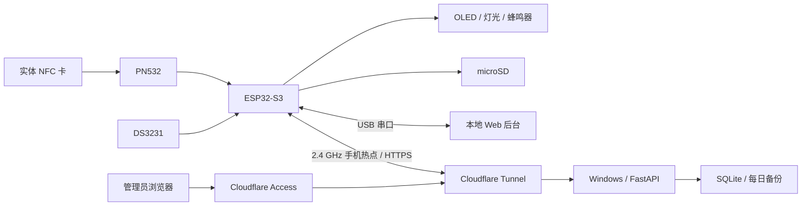

# NFC Attendance

基于 ESP32-S3 的 NFC 实验室签到终端，支持离线刷卡、microSD 持久化、USB 本地管理，以及通过手机热点连接的 Wi-Fi 远程管理。

终端先把签到记录写入 SD 卡并重新读取确认，再向用户提示成功。后台负责人员查询、每日统计、历史导出和设备管理。热点关闭时仍能签到，恢复网络后自动补传。

整体交付版本为 **v1.0**。该版本包含网络后台 **2.1.0**、固件 **0.10.0** 和兼容保留的 USB 后台 **1.0.0**。组件版本继续用于协议能力判断，与仓库发布版本独立。

## 功能

| 功能 | 当前行为 |
| --- | --- |
| NFC 签到 | 登记卡按自然日签到，每张卡每天一条记录 |
| 重复刷卡 | 显示已签到，不增加当天人数和记录 |
| 本地反馈 | OLED 显示日期、时间和结果；绿灯、红灯、蜂鸣器反馈 |
| 断网工作 | DS3231 走时，SD 存储，联网后补传 |
| USB 管理 | 连接串口、登记卡片、校时、读取名单和每日记录 |
| Wi-Fi 管理 | 设备配对、远程登记、校时、上传名单、重扫历史 |
| Web 后台 | 总览、记录筛选、人员备注、CSV 导出、SQLite 备份 |
| 上线 | Windows 常驻后台，Cloudflare Tunnel 回源，Access 保护管理页面 |

这里使用卡片 UID 识别身份。UID 可以被复制，本项目适合课程演示和低风险签到，不能作为门禁或强身份认证系统。手机复制卡功能依赖手机、卡型和厂商限制，基础验收使用实体 13.56 MHz NFC 卡。

## 系统结构



管理页面与设备 API 使用不同域名。示例分别为 `checkin.example.com` 和 `device-api.example.com`，均需替换为自己的域名。仓库没有可直接连接的公共演示服务器。

## 硬件与接线

主板使用 ESP32-S3 N16R8，16 MB Flash、8 MB PSRAM。固件会检查实际 Flash 和 PSRAM。模块应购买已焊排针版本；免焊连接仍须按接口标识核对极性。

| 模块 | 接线 | 电源和注意事项 |
| --- | --- | --- |
| PN532，SPI 模式 | SCK→12，MISO→13，MOSI→11，SS→10 | 当前模块接 3V3/GND；本次实物拨码 1=OFF、2=ON，其他版本按其丝印 |
| SH1106G OLED，128×64 | SDA→8，SCL→9，I2C 地址 0x3C | 3V3/GND；SSD1306 屏须调整驱动 |
| DS3231 | SDA→16，SCL→17，I2C 地址 0x68 | 3V3/GND；无充电电路版本配 CR2032 |
| 带稳压及电平转换的 SPI microSD 模块 | SCK→18，MISO→15，MOSI→14，CS→21 | 本次模块接独立稳压 5V，与主板共地；裸 3.3V 卡座不能照搬 |
| 有源蜂鸣器模块 | 信号→4 | 3.3V 逻辑，高电平有效 |
| 绿灯模块 | 信号→5 | 3.3V 逻辑，高电平有效；裸 LED 需串联限流电阻 |
| 红灯模块 | 信号→6 | 同上 |
| 按键 | GPIO7 与 GND | 内部上拉，低电平按下；长按约 3 秒进入配网 |

OLED 和 RTC 使用两条独立 I2C 总线；PN532 与 SD 使用两条独立 SPI 总线。杜邦线尽量短，插紧后用底板和扎带固定，避免移动时接触不良。

当前实物验收采用主板 COM USB 与 SD 独立 USB 两路供电。先接 SD 电源，再接主板电源；断电先拔主板，再拔 SD 电源。外部 5V 不接回主板 5V 引脚，所有模块共地。单插头分配供电需要确认电源容量、板载电源路径和防回灌后再实测，未纳入本版验收。

microSD 建议使用可靠的 FAT32 卡，先备份卡内文件。固件初始化失败时不会自动格式化，也不会删除旧签到文件。

## 目录

```text
src/                   ESP32-S3 固件和本地配置模板
lib/                   固定版本的 Adafruit / RTClib 依赖及许可证
certs/x509_crt_bundle   用于 HTTPS 校验的公共根证书数据
admin/                 USB / 网络后台、Web 页面和 Python 测试
admin/deploy/          Windows 安装、配置、常驻运行脚本
test/                  不依赖硬件的 C++ 回归测试与桩
tools/                 原生测试、公开内容检查、源码打包、证书生成
docs/                  项目简介、需求、设计、验收与部署文档
.github/workflows/     自动测试和固件编译
```

`admin/data/`、真实部署配置、热点凭据、导出记录、本地备份和构建产物由运行过程产生，均不进入 Git。仓库提供完整源码和模板，首次启动得到空数据库。

## 快速启动 USB 本地后台

安装 Git 和 Python 3.11 x64。在 PowerShell 中执行：

```powershell
git clone https://github.com/kujocailun/nfc-attendance.git
cd nfc-attendance
py -3.11 -m venv admin/.venv
admin/.venv/Scripts/python.exe -m pip install -r admin/requirements-lock.txt
admin/.venv/Scripts/python.exe admin/server.py --open
```

打开 `http://127.0.0.1:8765`。把主板 COM 口接到这台电脑，在“终端管理”的 USB 区域选择串口并连接。连接前关闭 PlatformIO Serial Monitor 等占用串口的程序。

Linux 可使用以下命令。串口通常为 `/dev/ttyACM*` 或 `/dev/ttyUSB*`，需要当前用户具备串口访问权限。

```sh
python3.11 -m venv admin/.venv
admin/.venv/bin/python -m pip install -r admin/requirements-lock.txt
admin/.venv/bin/python admin/server.py --open
```

USB-only 后台只依赖 `pyserial`，也可安装 `admin/requirements.txt`。完整锁定依赖同时支持网络后台和测试。Windows 创建虚拟环境后，也可运行 `admin/启动后台.cmd`。

## 编译和烧录固件

安装 PlatformIO Core 或 VS Code PlatformIO 扩展。构建目标已固定平台版本，第三方设备库随仓库提供。

```powershell
py -3.11 -m pip install platformio==6.1.19
pio run -e s3_n16r8
pio device list
pio run -e s3_n16r8 -t upload --upload-port COM7
```

`COM7` 为示例，使用实际识别到的 COM 端口。数据线应接主板标注 COM/UART 的接口；USB 口与 COM 口用途不同。上传会重启终端，避免正在写卡时操作。

Windows 工具链在中文项目路径中可能无法生成链接文件。此时先设置英文临时构建目录，再执行上述编译、上传命令；源码仍留在原目录：

```powershell
$env:PLATFORMIO_BUILD_DIR = Join-Path $env:TEMP 'nfc-attendance-build'
pio run -e s3_n16r8
```

默认配置适合编译和离线开发。联网上线前，复制并编辑本地配置：

```powershell
Copy-Item src/project_config.example.h src/project_config.h
```

```cpp
#pragma once
#define NFC_DEVICE_API_URL "https://device-api.example.com/device/v1/"
```

修改成自己的设备域名，保留 `/device/v1/` 和结尾斜杠，再编译。`project_config.h` 已被 Git 忽略。热点名称、密码、配对码通过配网页输入，不应写进源码。

普通应用上传不需要擦除整片 Flash。`erase_flash` 会清除 NVS 中的热点配置和设备凭据，重新配对前不要执行。升级前备份 SD 和后台数据库。

## 日常操作

1. 上电后确认 RTC 正常走秒、SD 可用。初次使用先校时。
2. 刷未登记卡，读取其 UID，在后台登记名称；OLED 默认英文字库，短英文名显示更完整。
3. 刷已登记卡，第一次成功后显示 `CHECK-IN SAVED`，绿灯和蜂鸣器反馈。
4. 拿开卡至少 2 秒后再刷，应提示 `ALREADY CHECKED IN`，当天人数不变。
5. 检查后台记录。网络中断期间产生的有效记录会在恢复连接后重传，后台按事件标识去重。

SD 文件布局如下。示例卡号和姓名是测试数据：

```text
/members.csv
    uid,name
    04-11-22-33,student
/attendance/YYYY-MM-DD.csv
    time,uid,name,status
    YYYY-MM-DD HH:MM:SS,04-11-22-33,student,SAVED
```

实际日期和时间必须有效。后台导出的管理报表额外带人员备注列，终端 CSV 导入接口只接受四列原始格式；不要把管理报表原样再导入终端历史。

时钟无效、SD 写入失败或名单损坏时，终端拒绝确认签到成功。红灯或错误提示出现后先处理故障，避免仅凭刷到 UID 判断签到已保存。

## 手机热点与远程部署

完整步骤见 [Windows 上线部署](docs/DEPLOYMENT.md)。生产电脑需要长期运行；终端只需连接能上网的热点，无需与生产电脑处在同一局域网。

安卓热点使用 **2.4 GHz、WPA2 兼容模式**，关闭“无连接自动关闭热点”。后台先生成有效期 10 分钟的一次性配对码，再长按终端按键约 3 秒。OLED 显示 `SETUP-…`、随机密码和 `192.168.4.1` 后：

1. 关闭手机热点，用手机 Wi-Fi 连接终端的 `SETUP-…`。
2. 浏览器打开 `http://192.168.4.1/`，填入手机热点名称、密码和配对码。
3. 保存后断开终端 Wi-Fi，重新开启原来的手机热点。
4. 等待终端联网、后台显示设备在线。配置经后台确认后才成为正式配置。

同一手机通常无法同时连接终端 AP 并提供热点，以上切换过程是正常流程。已配对设备只更换热点时，配对码可留空。改错候选配置不会立即覆盖原来的可用配置。

日常只需开启同名、同密码的热点。关闭热点后终端继续本地签到；重新打开会自动重连。后台可能在约 3 分钟后才把设备显示为离线，这取决于心跳超时。

## 远程命令与数据一致性

| 操作 | 终端完成条件 |
| --- | --- |
| 登记卡片 | 名单写入后重新读回对应 UID 和名称，回执 `SD_READBACK_OK` |
| 校时 | 设置 RTC 并读取核对，回执 `RTC_READBACK_OK` |
| 读取名单 | 终端上传当前名单，后台确认，回执 `ROSTER_UPLOADED` |
| 重扫历史 | 本次读到的记录都被后台确认，回执 `HISTORY_SCAN_ACKED` |

任务依次进入 `pending`、`running`、`done` 或 `failed`。终端离线时任务保留在队列中，联网后领取。网页提交成功只代表任务入队，应等待最终回执。

名单同步方向为终端到后台，并保留后台学号、分组、备注。历史重扫回执只证明本次实际读到的记录被确认，不代表某天文件完整无缺。当前不提供改绑定名称和删除卡片接口。

心跳约 60 秒、任务轮询约 30 秒、历史复查约 5 分钟；请求失败会重试。Wi-Fi/TLS 在独立任务中处理，SD 访问留在主循环，减少网络故障对本地刷卡的影响。

## 测试

Python 依赖安装完成后，在仓库根目录运行：

```powershell
admin/.venv/Scripts/python.exe -m unittest discover -s admin/tests -p "test_*.py" -v
node --test admin/tests/test_status_refresh.cjs
admin/.venv/Scripts/python.exe tools/test_native.py
pio run -e s3_n16r8
admin/.venv/Scripts/python.exe tools/check_public.py
```

原生测试要求 PATH 中有 C++17 编译器，或传 `--compiler C:/mingw64/bin/g++.exe`。Node.js 22 用于前端状态回归，运行后台无需 Node 或 npm。

当前自动回归包括 41 项 Python 测试、12 项前端测试及 5 组 C++ 程序，覆盖重复签到、写入读回、损坏文件、断网重放、远程任务回执、Access 签名验证和表头状态稳定性。CI 同时构建固件。[测试验收文档](docs/TESTING.md) 区分软件回归与实物测试。

## 备份与维护

后台“备份数据库”使用 SQLite 一致性备份接口。网络后台自动生成每日备份，保留最近 14 份，位置为 `admin/data/backups/`。备份包含真实人员和设备信息，应按业务数据保护。

恢复前停止后台进程或计划任务，备份当前 `admin/data/`，再以备份替换 `attendance.sqlite3`。不要在进程运行时只复制主数据库文件并忽略 WAL。恢复后核对人数、名单和设备状态；恢复到较早备份可能丢失之后的配对，需要重新配对。

SD 是终端离线记录来源，建议单独备份 `/members.csv` 和 `/attendance/`。数据库备份不能替代 SD 备份。设备凭据撤销后旧设备不能继续上传；应检查后台再重新配对。

## 常见问题

| 现象 | 检查方向 |
| --- | --- |
| 没有串口 | 接主板 COM 口，确认数据线、串口芯片驱动和设备管理器 |
| OLED 亮但 PN532 无响应 | 断电检查 SPI 拨码、四根信号线、供电和共地 |
| SD 初始化失败 | 确认模块供电规格、独立 5V 极性、共地、插卡和 SPI 接线；勿直接认定是卡坏 |
| 刷卡提示未登记 | 读取实际 UID 后登记；示例卡号不代表自己的测试卡 |
| 热点连接失败 | 2.4 GHz/WPA2、名称密码、手机自动关闭策略和互联网可用性 |
| 配对失败 | 检查配对码是否过期、设备域名是否正确、TLS 时间与证书验证是否通过 |
| 网页任务一直等待 | 确认设备在线、固件上报支持该能力；离线任务需等重新连接 |
| 管理域名 401/403 | 核对 Access 应用 AUD、team issuer、允许邮箱和服务器配置 |
| 表头偶尔变成 USB 未连接 | 检查前端是否为本版源码，勿用旧的单文件补丁覆盖 `app.js`、`network.js` |

## 课程文档与发布

五阶段材料见 [项目简介](docs/PROJECT.md)、[需求分析](docs/REQUIREMENTS.md)、[系统设计](docs/DESIGN.md)、[测试验收](docs/TESTING.md) 和 [成果汇报提纲](docs/REPORT.md)。材料使用通用示例，不含个人学号、班级、真实部署域名或现场签到记录。

Git 历史从经过脱敏的公开基线开始，按固件、后台、文档与验证工具分提交。历史阶段交付 ZIP、现场照片和运行数据库保留在本地，不属于发布内容。

`.gitignore` 使用根目录和后台工具白名单，同时忽略私有配置与运行数据。新增公开文件时可能需要调整白名单。提交前运行 `tools/check_public.py --staged`，再检查 `git diff --cached`；忽略规则不能清除已经提交的文件或历史。

发布源码包可运行 `python tools/package_source.py ../nfc-attendance-v1.0-source.zip`。该工具只打包 Git 跟踪的文件并复查解压内容。本版不分发生产配置、数据库、旧固件二进制或带现场信息的截图。

自有代码暂未指定开源许可证，公开可见性不等于额外授权。第三方依赖保留原许可证，详见 [THIRD_PARTY_NOTICES.md](THIRD_PARTY_NOTICES.md)。安全问题处理见 [SECURITY.md](SECURITY.md)。
