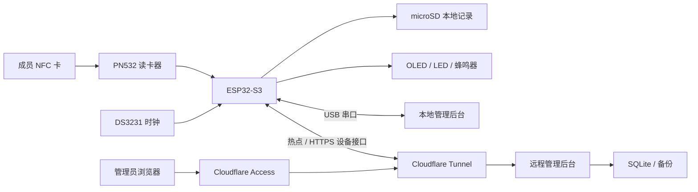

# NFC Attendance

## 离线可用的实验室 NFC 签到系统

**本项目面向小型实验室管理员，解决现场网络不稳定时签到记录难以连续留存和集中汇总的问题。**

成员使用已登记的 NFC 卡在终端刷卡。终端独立记录时间、保存签到数据并显示结果；联网后把记录上传到浏览器后台，管理员可以查询、导出和备份。手机热点关闭时，已登记卡仍可签到。

项目由 ESP32-S3 硬件终端、嵌入式固件和 Web 管理后台组成，适合嵌入式课程实践、小型实验室签到及离线数据采集原型研究。当前支持一台联网终端、一个管理员和至多 128 张登记卡。

[快速开始](#快速开始) · [硬件连接](#硬件连接) · [Wi-Fi 部署](#wi-fi-部署与手机热点) · [测试](#开发与测试) · [课程文档](#项目文档)

## 使用过程

管理员先为卡片登记名称，再把终端放到签到位置。成员刷卡后，终端将记录写入 microSD 卡并重新读取核对，通过后显示 `CHECK-IN SAVED`。同一卡片当天再次刷卡显示 `ALREADY CHECKED IN`，记录数保持不变。

签到按北京时间的自然日划分，以卡片 UID 为单位。同一人持有两张卡会分别计数；系统不会自动合并为一个人。后台“当日未见签到”只反映已收到的数据，不能直接当作缺勤结论。

| 操作 | 终端或后台的行为 |
| --- | --- |
| 登记卡首次签到 | 写入时间、UID、姓名与状态，确认保存后声光提示 |
| 同日重复刷卡 | 提示已签到，不重复保存 |
| 未登记卡刷卡 | 提示 `UNKNOWN CARD`，可据 UID 进行登记 |
| 热点中断 | 继续本地签到，恢复联网后自动补传并去重 |
| 查询与导出 | 按日期、姓名或卡号检索，导出 CSV，下载数据库备份 |
| 终端维护 | 登记卡片、校时、读取名单、同步历史及查看设备状态 |

卡片 UID 是可读取、可能被复制的标识。本项目面向低风险签到，不提供门禁级身份认证，也不验证刷卡人是否为卡片持有人。

## 两种运行方式

| 比较项 | USB 本地管理 | Wi-Fi 远程管理 |
| --- | --- | --- |
| 终端连接 | COM/UART USB 接运行后台的电脑 | 连接可上网的 2.4 GHz Wi-Fi 或安卓热点 |
| 管理入口 | `http://127.0.0.1:8765` | 自行部署的 HTTPS 管理域名 |
| 电脑要求 | 管理和同步时连接终端 | 后台电脑需保持运行并联网 |
| 额外服务 | 无需域名或云服务 | Cloudflare Tunnel、Access 和自有域名 |
| 适用场景 | 第一次搭建、现场维护、离线演示 | 终端脱离管理电脑摆放，跨网络管理 |

初次搭建建议先完成 USB 模式，再配置 Wi-Fi。联网后台也保留 USB 维护入口，页面列出的是**后台所在电脑的串口**，远程浏览器不能通过它直接读取浏览器所在电脑的 USB。

## 系统结构



设备接口与管理页面使用两个域名，分别进行设备密钥和管理员身份认证。终端的本地签到不依赖后台实时响应。

## 快速开始

### 1. 准备环境与源码

主要验证环境为 Windows、Python 3.11 x64 和 ESP32-S3 N16R8。编译固件使用 PlatformIO，运行后台无需 Node.js；Node.js 和 C++ 编译器仅用于开发测试。

```powershell
git clone https://github.com/kujocailun/nfc-attendance.git
cd nfc-attendance
py -3.11 -m venv admin/.venv
admin/.venv/Scripts/python.exe -m pip install -r admin/requirements-lock.txt
```

仓库首次运行会生成空数据库，没有预置人员、已登记测试卡或可直接连接的演示服务器。本文中的 `example.com`、`student` 和示例 UID 均需按实际情况配置。

### 2. 连接硬件并烧录

按下文[硬件连接](#硬件连接)表接线，断电操作，检查电源极性与共地后上电。把主板 COM/UART 口接到电脑。

```powershell
py -3.11 -m pip install platformio==6.1.19
py -3.11 -m platformio device list
py -3.11 -m platformio run -e s3_n16r8
py -3.11 -m platformio run -e s3_n16r8 -t upload --upload-port COM7
```

`COM7` 是示例端口，以实际识别结果为准。烧录会重启终端，应避开刷卡写入过程。普通上传保留 NVS；擦除整片 Flash 会清除热点配置和设备凭据。

Windows 下若项目路径含中文且链接器报告无法生成 `.map` 文件，可先指定英文构建目录，再执行编译和上传命令：

```powershell
$env:PLATFORMIO_BUILD_DIR = Join-Path $env:TEMP 'nfc-attendance-build'
py -3.11 -m platformio run -e s3_n16r8
```

默认固件可以离线运行；Wi-Fi 功能需完成[设备地址配置](#设备地址配置)后重新编译。

### 3. 启动管理后台

```powershell
admin/.venv/Scripts/python.exe admin/server.py --open
```

浏览器打开 `http://127.0.0.1:8765`，在“终端管理”选择串口并连接。连接前关闭其他串口监视器。确认终端时间有效、读卡器和 SD 正常；初次使用先执行校时。

终端上标记为 COM/UART 的接口用于本流程，另一原生 USB 接口不能直接按相同接线假定使用。断开后台的串口连接后，保留供电即可继续独立签到。

Linux 可使用 Python 3.11 创建虚拟环境，以 `admin/.venv/bin/python admin/server.py --open` 启动。串口一般为 `/dev/ttyACM*` 或 `/dev/ttyUSB*`，需要当前用户具备访问权限。完整硬件和部署验收以 Windows 环境为准。

### 4. 完成一次签到验证

1. 刷一张测试卡，终端应提示未登记；在后台登记新卡片，可使用“最近刷卡”填入 UID，并核对实物卡。
2. 输入演示名称，例如 `student`，等待终端确认登记成功。
3. 把卡移开至少 2 秒，再刷一次，应显示 `CHECK-IN SAVED`，当日记录增加一条。
4. 再移开并刷同卡，应显示 `ALREADY CHECKED IN`，人数和记录数保持不变。
5. 在后台读取当天记录，确认姓名、UID、时间和状态。随后可筛选导出或下载数据库备份。

时间无效、名单异常或 SD 写入失败时，终端会显示错误并拒绝确认成功。读到 UID 不等于签到已保存。

## 硬件连接

### 材料

| 部件 | 数量 | 规格 |
| --- | --- | --- |
| ESP32-S3 开发板 | 1 | N16R8，16 MB Flash、8 MB PSRAM，排针已焊 |
| PN532 模块 | 1 | 支持 SPI，排针已焊 |
| NFC 测试卡 | 至少 2 | 兼容 ISO/IEC 14443A，例如 MIFARE Classic S50；UID 为 4 或 7 字节 |
| OLED | 1 | SH1106G，128×64，I2C，地址 0x3C |
| DS3231 与电池 | 1 组 | 无充电电路模块，CR2032 |
| SPI microSD 模块与卡 | 1 组 | 下表采用带稳压和电平转换、5V 供电的模块；卡使用 FAT32 |
| 有源蜂鸣器、红绿 LED 模块 | 各 1 | 兼容 3.3V 信号，高电平有效 |
| 独立按键 | 1 | GPIO 对地触发 |
| 连接与供电材料 | 1 组 | 杜邦线、可靠分线端子、USB 数据线、稳压电源与固定件 |

其他 OLED 控制器、裸 SD 卡座或接口不同的读卡模块需要调整驱动与电路，不能仅凭外观替换。

### 引脚

表中数字均为 **GPIO 编号**，不是排针从上到下的位置。

| 模块 | 信号连接至 ESP32-S3 | 电源 |
| --- | --- | --- |
| PN532，SPI | SCK→12，MISO→13，MOSI→11，SS/CS→10 | 兼容模块接 3V3、GND |
| OLED | SDA→8，SCL→9 | 3V3、GND |
| DS3231 | SDA→16，SCL→17 | 3V3、GND |
| microSD 模块 | SCK→18，MISO→15，MOSI→14，CS→21 | 适配模块接独立 5V、共地 |
| 有源蜂鸣器模块 | S/IN→4 | 兼容模块接 3V3、GND |
| 绿 LED 模块 | S/IN→5 | 兼容模块接 3V3、GND |
| 红 LED 模块 | S/IN→6 | 兼容模块接 3V3、GND |
| 按键 | 一端→7，另一端→GND | 使用内部上拉 |

PN532 需设为 SPI 模式。已验证模块的两位拨码为 1=OFF、2=ON；不同 PCB 以厂商模式表为准。OLED 与 RTC 使用独立 I2C，PN532 与 SD 使用独立 SPI；SD 总线频率设为 400 kHz。

### 供电与存储

参考原型采用主板 COM USB、SD 模块独立 USB 两路供电并共地。上电先接 SD、再接主板；断电先拔主板、再拔 SD。外部 5V 不接回主板 5V 引脚。单电源版本需要另外验证供电路径、防回灌和启动时序。

上述 SD 接法只适用于输入端支持 5V 的模块，裸卡座应按其 3.3V 要求设计。裸 LED 需串联限流电阻。免焊连线应固定牢靠，SPI 信号线尽量短。

首次插卡前备份原文件并确认 FAT32。固件不会在初始化失败时自动格式化。DS3231 使用 CR2032 时，必须确认模块没有给电池充电的电路。

## Wi-Fi 部署与手机热点

远程模式需要先部署后台，再配置固件和配对终端。[Windows 部署指南](docs/DEPLOYMENT.md)给出了 Tunnel、Access、配置生成和开机启动步骤。

| 配置 | 示例 | 用途 |
| --- | --- | --- |
| 管理域名 | `checkin.example.com` | 浏览器访问，Cloudflare Access 限定管理员 |
| 设备域名 | `device-api.example.com` | 终端 HTTPS 接口，设备密钥认证 |
| 隧道回源 | `http://127.0.0.1:18080` | 同一后台进程处理两种域名 |

Windows 后台通过计划任务常驻，`cloudflared` 通过 Windows 服务运行。后台电脑和终端可以在不同网络。参考部署无需向互联网开放电脑的入站端口。

### 设备地址配置

在仓库根目录复制模板：

```powershell
Copy-Item src/project_config.example.h src/project_config.h
```

修改本地文件中的设备 API 地址，然后重新编译、烧录：

```cpp
#pragma once
#define NFC_DEVICE_API_URL "https://device-api.example.com/device/v1/"
```

使用自己的 HTTPS 域名，保留 `/device/v1/` 和结尾斜杠。`src/project_config.h` 与 `admin/network-config.json` 均由 Git 忽略；热点密码和设备密钥通过配网生成、保存，不写入源码。

### 首次配对

1. 安卓热点选择 **2.4 GHz、WPA2 兼容模式**，固定名称与密码，关闭“无连接自动关闭热点”。
2. 登录管理后台，在终端管理中生成一次性配对码，有效期 10 分钟。
3. 长按终端按键约 3 秒，OLED 显示 `SETUP-…`、随机密码和 `192.168.4.1`。
4. 关闭手机热点，用 Wi-Fi 连接这个终端 AP，在浏览器打开 `http://192.168.4.1/`。
5. 填入手机热点名称、密码和配对码，保存后断开终端 AP，再开启手机热点。
6. 等待后台出现在线设备。候选配置经服务器验证后才替换正式配置，失败时保留原可用配置。

同一安卓手机通常需要在连接终端 AP 和提供热点之间切换。日常使用只需打开原来的热点，终端会自动重连；已配对设备更换热点可在配网页留空配对码。

心跳通常约 60 秒上报一次，后台约 3 分钟未收到通信才显示离线。网页时间和最近卡号是上次上报值，页面刷新不会强制终端立即上报。TLS 依赖可信时间，网络应允许终端获取网络时间并访问 HTTPS 设备域名。

## 远程操作与结果确认

远程管理采用持久化任务队列。点击按钮后，任务先进入 `pending`，终端领取后为 `running`，收到结果后为 `done` 或 `failed`。离线任务等待终端重新连接，入队提示不代表操作已经完成。

| 操作 | 完成依据 |
| --- | --- |
| 登记卡片 | 名单写入后重新读取确认，回执 `SD_READBACK_OK` |
| 立即校时 | RTC 设置并读回核对，回执 `RTC_READBACK_OK` |
| 同步名单 | 终端向后台上传名单并获确认，回执 `ROSTER_UPLOADED` |
| 重扫历史 | 本轮实际读到的记录逐条获确认，回执 `HISTORY_SCAN_ACKED` |

联网状态下通常约 30 秒轮询任务，实际执行还受当前请求与网络状况影响。历史重扫按终端所有历史文件进行，日期筛选只影响网页查询，不会限制重扫范围。重扫完成不能据此认定某天记录完整。

名单从终端同步到后台，保留后台编号、分组和备注。当前不支持删除卡片或直接修改已有绑定姓名。Wi-Fi/TLS 在独立任务处理，SD 访问由主循环执行。

## 数据与备份

终端 SD 保存两类文件，均使用 UTF-8 文本：

```text
/members.csv                 表头 uid,name
/attendance/YYYY-MM-DD.csv   表头 time,uid,name,status
```

原始签到 CSV 行示例为 `2026-01-01 09:00:00,04-11-22-33,student,SAVED`。这是合成数据，实际文件必须使用合法时间与已登记卡号，并以换行结束。

后台默认保存到 `admin/data/attendance.sqlite3`。管理报表导出包含额外的人员字段，CSV 导入只接收终端四列原始记录；管理报表不能原样再次导入。后台用事务和唯一约束处理重复数据，内容冲突会报错。

网络后台通过 SQLite 一致性备份接口生成每日备份，保留最近 14 份于 `admin/data/backups/`，也支持手动下载。恢复前停止后台，备份现有数据目录，再替换数据库并检查名单、记录和设备配对。不要在运行中仅复制主库而遗漏 WAL 文件。

SD 与后台数据库分别备份。凭据、人员信息、签到记录和备份都应保存在受控位置；公开仓库只提供空库初始化逻辑与配置模板。

## 开发与测试

| 路径 | 内容 |
| --- | --- |
| `src/` | 主控固件、模块驱动调用、签到和网络逻辑 |
| `lib/` | 固定版本的设备库及原许可证 |
| `certs/` | HTTPS 公共根证书集合，无设备私钥 |
| `admin/` | Python 后台、原生 Web 页面与 Windows 部署脚本 |
| `test/`、`admin/tests/` | 固件原生回归、后台和前端测试 |
| `tools/` | 测试运行、公开内容检查、源码打包与证书生成 |
| `.github/workflows/` | 后台测试、前端测试、C++ 回归和固件构建 |

在根目录运行以下命令；C++ 测试需要 C++17 编译器，前端测试使用 Node.js 22：

```powershell
admin/.venv/Scripts/python.exe -m unittest discover -s admin/tests -p "test_*.py" -v
node --test admin/tests/test_status_refresh.cjs
admin/.venv/Scripts/python.exe tools/test_native.py
pio run -e s3_n16r8
admin/.venv/Scripts/python.exe tools/check_public.py
```

编译器不在 PATH 中时，可为 `test_native.py` 传入 `--compiler C:/mingw64/bin/g++.exe`。当前回归基线为 41 项 Python、12 项前端测试和 5 组 C++ 程序，另有 ESP32 目标构建。[测试文档](docs/TESTING.md)列出实物验收范围，主机桩测试不替代供电、介质和无线链路实测。

## 常见问题与限制

| 情况 | 处理方向 |
| --- | --- |
| 没有串口或无法连接 | 确认 COM/UART 接口、数据线和驱动，关闭占用串口的程序 |
| OLED 亮但无法读卡 | 断电检查 PN532 SPI 模式、信号针脚、供电与共地 |
| SD 初始化失败 | 按模块规格检查实际输入电压、共地、插卡、文件系统和 SPI 连线 |
| 热点或配对失败 | 检查 2.4 GHz/WPA2、互联网、配对码有效期、设备域名与 TLS 时间 |
| 远程任务等待 | 确认设备在线且上报相应能力，检查最终回执 |
| 管理域名返回 401/403 | 核对 Access issuer、应用 AUD、允许邮箱和生产配置 |
| OLED 不显示中文姓名 | 默认字库不包含中文，后台可保存中文，终端使用 UID 等替代显示 |

目前未完成长期连续运行、128 卡实物满载和大规模历史性能测量。参考原型仍为两路供电，生产电脑整机重启后的完整自恢复需要部署者复测。设备 NVS 未启用 Flash Encryption；物理读取 Flash 可能取得热点配置与设备凭据。

## 项目文档

| 文档 | 阅读目的 |
| --- | --- |
| [课程项目简介](docs/PROJECT.md) | 作品名称、服务对象、主要问题和简要功能 |
| [完整交付报告](docs/DELIVERY_REPORT.md) | 按立项、需求、设计、验收、汇报五阶段说明成果 |
| [需求分析](docs/REQUIREMENTS.md) | 功能编号、验收标准和边界 |
| [系统设计](docs/DESIGN.md) | 模块、存储与协议 |
| [Windows 部署](docs/DEPLOYMENT.md) | 远程后台和 Cloudflare 接入 |
| [测试与验收](docs/TESTING.md) | 回归方法及实物证据范围 |
| [演示提纲](docs/REPORT.md) | 课堂演示顺序和准备材料 |

## 版本与使用说明

[v1.0](https://github.com/kujocailun/nfc-attendance/releases/tag/v1.0) 是整体交付标签，包含固件 0.10.0、网络后台 2.1.0 和 USB 后台 1.0.0。组件版本用于协议兼容判断。`main` 可包含后续文档修订，需要固定源码时使用发布标签。

`.gitignore` 排除运行数据和私有配置，并对白名单目录以外的文件默认忽略。提交前检查 `git diff --cached` 并运行 `tools/check_public.py --staged`。详细安全边界见 [SECURITY.md](SECURITY.md)。

自有代码尚未指定开源许可证，公开仓库不等于授予额外使用许可。第三方组件遵循各自许可证，见 [THIRD_PARTY_NOTICES.md](THIRD_PARTY_NOTICES.md)。
