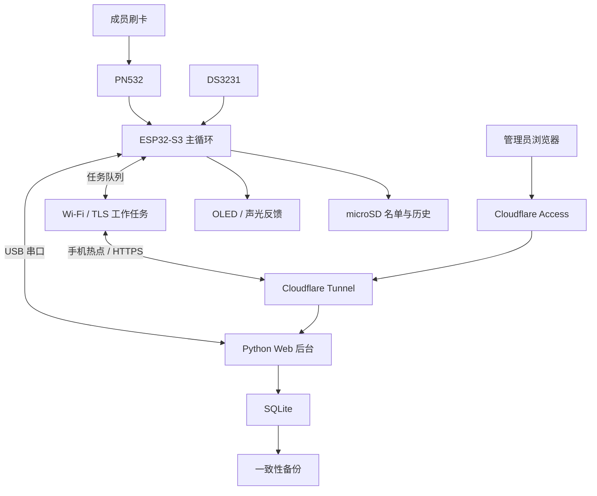
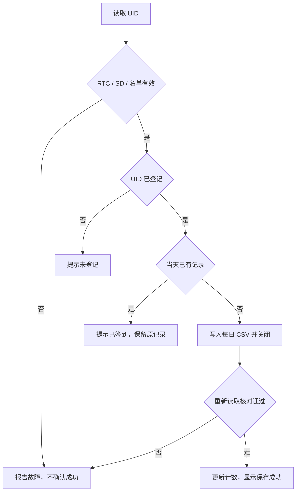
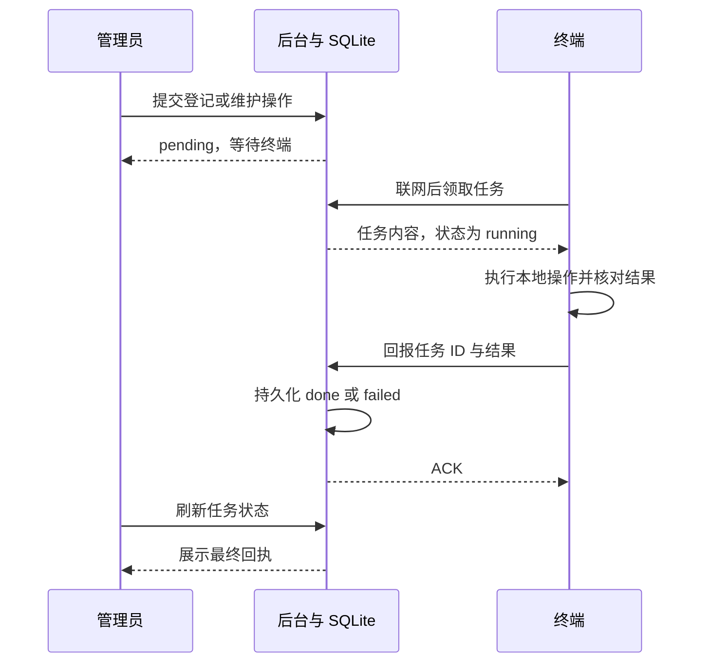

# 项目完整交付报告

**基于 ESP32-S3 的离线 NFC 实验室签到与管理系统**

| 项目 | 内容 |
| --- | --- |
| 报告整理日期 | 2026 年 11 月 9 日 |
| 软件交付基线 | v1.0 |
| 固件 / 网络后台 / USB 后台 | 0.10.0 / 2.1.0 / 1.0.0 |
| 交付形态 | 硬件原型、固件源码、Web 后台、部署脚本、测试与文档 |
| 使用范围 | 小型实验室日常签到与课程演示 |

**本项目面向小型实验室管理员，解决现场网络不稳定时签到记录难以连续留存和集中汇总的问题。**

## 摘要

本项目实现了一套能够离线工作的 NFC 签到终端及配套管理后台。成员使用已登记卡片刷卡，ESP32-S3 根据 DS3231 时间进行同日去重，将记录写入 microSD 并重新读取确认，再通过 OLED、LED 和蜂鸣器反馈结果。终端连接 Wi-Fi 或手机热点后上传本地历史，后台使用事件标识、事务和唯一约束去重，供管理员查询、导出与备份。

系统提供 USB 本地管理和 Wi-Fi 远程管理。远程登记、校时、名单读取和历史重扫通过持久化任务队列执行，以终端确认回执表示完成。生产部署采用 Windows 常驻后台和 Cloudflare Tunnel，管理页面通过 Cloudflare Access 认证，设备接口使用独立密钥认证。

v1.0 已通过 41 项 Python 测试、12 项前端测试、5 组 C++ 原生回归及 ESP32-S3 目标构建，完成读卡、显示、RTC 断电保持、SD 持久化、远程任务、热点重连与整机断电重启等实物联调。系统仍为一台终端、至多 128 张卡的原型；长期稳定性、实物满容量及更强身份认证需要后续验证和设计。

本文按课程的立项、需求分析、系统设计、测试验收和成果汇报五个阶段整理，测试结论区分自动回归、实物观察与待验证项。

## 一、项目立项

### 1.1 服务对象与主要问题

直接服务对象为小型实验室管理员，现场使用者为实验室成员。管理员需要获得能用于汇总的签到记录；成员需要在刷卡时知道本次记录是否已经保存。

现场网络由路由器或手机热点提供，可能临时关闭或断开。若签到必须等待服务器响应，网络故障会影响现场记录；若记录只留在终端，管理员还需要整理和汇总。项目把现场保存放在终端，把集中查询放在后台，让网络中断与记录保存解耦。

项目的验收主线是“记录能否留下并被可靠汇总”。读卡、时钟、存储、显示和后台都围绕这条主线设计。

### 1.2 项目目标与成功标准

| 目标 | 成功标准 |
| --- | --- |
| 现场可用 | 已登记卡在网络不可用时仍能按本地规则签到 |
| 结果可信 | 写入并读回成功后才确认，故障时有明确提示 |
| 记录不重复 | 同卡同自然日一次，重复刷卡与重复上传不增加记录 |
| 管理可追踪 | 管理员能查询来源记录，远程操作能看到最终结果 |
| 交付可复现 | 提供引脚、环境、构建、部署、备份和复测说明 |

不使用“减少多少人工时间”“准确率达到多少”作为已实现成果，因为本版没有开展对照实验和统计测量。

### 1.3 方案可行性分析

| 方案 | 优点 | 对本项目的影响 |
| --- | --- | --- |
| 在线网页或扫码签到 | 部署终端简单 | 依赖现场网络和成员手机，离线记录需另外设计 |
| NFC 终端仅存本地 | 现场离线可用 | 管理员仍需人工汇总，远程维护困难 |
| NFC 本地保存并联网同步 | 能独立签到，也能集中汇总 | 需要处理去重、任务确认和连接恢复，本项目采用 |

ESP32-S3 能连接 SPI、I2C 外设并运行 Wi-Fi/TLS；所需数据量较小，可用 SD 和 SQLite 保存。USB 先完成模块验证，再扩展 Wi-Fi，能够逐步缩小故障范围。采用模块化硬件和免焊连接便于课程原型搭建，但接插件稳定性需要额外固定和检查。

成本由主控、PN532、OLED、RTC、SD、声光按键及供电连接材料构成。本文给出材料规格，不把购物车估价当作实际采购成本；实际支出需以订单整理，未核实总额不计入交付结论。

### 1.4 范围控制

第一版支持一台联网终端、一个管理员、128 张登记卡。签到按卡片和北京时间自然日统计，未实现多设备联合考勤、排班迟到、请假审批、删除卡片和直接修改绑定姓名。

卡片只读取 UID，不对持卡人做身份核验，也不防止 UID 复制。手机模拟卡的能力受机型、卡型和系统限制，因此使用实体卡验收。单电源外壳整合、中文屏幕和长期运行测试列入后续工作。

## 二、需求分析

### 2.1 角色与业务流程

| 角色 | 操作 | 需要得到的结果 |
| --- | --- | --- |
| 实验室成员 | 刷已登记卡、查看提示 | 明确保存成功、重复签到或故障 |
| 管理员 | 登记、校时、同步、查询、导出 | 能核对记录和维护终端 |
| 部署维护者 | 运行后台、接入域名、备份与恢复 | 服务可维护，配置与业务数据受控 |

首次使用先检查时间和 SD，管理员为卡片绑定名称。日常由终端独立签到，后台收到记录后用于查询；现场网络恢复时再同步未确认数据。需要维护时可使用 USB，也可发送远程任务并等待回执。

### 2.2 业务规则

| 编号 | 规则 |
| --- | --- |
| B01 | UID 为 4 或 7 字节，使用大写十六进制与连字符表示 |
| B02 | 每张登记卡每天一条记录，以终端 RTC 中的北京时间自然日为准 |
| B03 | 重复刷卡保留首次记录，不用第二次刷卡时间覆盖 |
| B04 | 同一人多卡分别计数，后台不自动合并身份 |
| B05 | 姓名不超过 48 个 UTF-8 字节，禁止影响 CSV 格式的字符和公式起始符 |
| B06 | 未登记卡不产生有效签到，时间或存储不健康时不确认成功 |
| B07 | 终端记录完成须写入后重新读取核对，远程操作完成须有对应回执 |
| B08 | 统计依赖后台已收到的数据，“未见签到”不直接认定为缺勤 |

校时会影响自然日判断。当前没有可信时间防篡改和排班规则，管理员应核对时区与日期，避免在工作期间将时钟调到错误日期。

### 2.3 功能需求与实现对应

沿用需求文档中的 F01～F11，便于从需求追踪到源码和验收。

| 编号 | 需求 | 实现位置 | 验证依据 |
| --- | --- | --- | --- |
| F01 | 读卡及 UID 绑定 | `nfc.cpp`、`attendance.cpp` | 实物读卡登记，参数与冲突回归 |
| F02 | 每卡每天一次 | `attendance.cpp` | 实物连刷、重启重复刷，签到回归 |
| F03 | 时间、名单与 SD 检查 | `clock.cpp`、`attendance.cpp` | RTC 检查及错误路径回归 |
| F04 | 写入后读回确认 | `attendance.cpp`、`storage.cpp` | SD 实测及短读、短写、损坏注入 |
| F05 | 掉电后保留记录与时间 | SD 文件、DS3231 | 断电重启实测 |
| F06 | USB 登记、校时、名单和历史 | `device.py`、`server.py` | 实物联调、mock 传输和 HTTP 回归 |
| F07 | 离线运行与重连补传 | `network.cpp`、`network_sync.h` | 热点重连实测、离线事件重放回归 |
| F08 | 远程排队与最终结果 | `netstore.py`、固件网络模块 | 实物队列操作及回执回归 |
| F09 | 查询、备注、导出、备份 | `database.py`、Web 页面 | 数据库与 HTTP 自动回归 |
| F10 | 管理与设备分域认证 | `network_server.py` | JWT、Host、密钥与撤销测试 |
| F11 | 本地 AP 配网、候选配置 | `network.cpp` | AP 显示、首次配置及热点连接联调 |

### 2.4 非功能要求

可靠性要求主要落在异常时的行为。SD 初始化失败不能自动格式化；记录内容冲突不能静默覆盖；远程请求成功不能冒充设备执行成功。网络等待由独立任务处理，本地 SD 访问保持单一执行入口。

可维护性要求包括模块分离、串口诊断、可复现依赖、部署说明和备份流程。状态页面展示最近通信时间，帮助管理员区分设备离线和页面刷新延迟。

安全与隐私要求包括管理认证、设备凭据隔离、修改请求令牌、输入校验，以及公开交付前去除业务数据和实际配置。本版没有量化响应时间服务承诺，轮询周期只是实现参数。

## 三、系统设计与实现

### 3.1 总体架构



终端是现场记录来源，后台是汇总与维护入口。网络请求和本地记录分开处理，连接故障不会直接取消本地签到。后台一台电脑即可运行 Python 服务和 SQLite，适合当前规模。

### 3.2 硬件设计

| 部件 | 数量 | 接口与引脚 | 作用 |
| --- | --- | --- | --- |
| ESP32-S3 N16R8 | 1 | 16 MB Flash、8 MB PSRAM | 主控与网络 |
| PN532 | 1 | SPI，SCK12 / MISO13 / MOSI11 / SS10 | 读实体 NFC 卡 |
| SH1106G OLED | 1 | I2C，SDA8 / SCL9，0x3C | 时间、结果和配网信息 |
| DS3231 与 CR2032 | 1 组 | I2C，SDA16 / SCL17，0x68 | 断电保持时间 |
| microSD 模块与卡 | 1 组 | SPI，SCK18 / MISO15 / MOSI14 / CS21 | 名单和每日记录 |
| 有源蜂鸣器模块 | 1 | GPIO4，高电平有效 | 提示音 |
| 绿 / 红 LED 模块 | 各 1 | GPIO5 / GPIO6，高电平有效 | 状态反馈 |
| 按键 | 1 | GPIO7 对地、内部上拉 | 本地交互和长按配网 |
| 供电、连线、固定件 | 1 组 | 两路 USB、共地、分线端子 | 供电与原型固定 |
| 实体测试卡 | 至少 2 | 兼容 ISO/IEC 14443A | 登记与重复场景测试 |

PN532 和 SD 分别使用独立 SPI；OLED 和 RTC 分别使用独立 I2C。这样便于定位故障，也避免把接口配置混在同一总线上。SD 频率设为 400 kHz，优先适配原型连线。

参考原型的 SD 模块带稳压与电平转换，使用独立 5V，主板通过 COM USB 供电并共地。其他模块按已验证的 3.3V 接口接入。外部 5V 不接回主板 5V 引脚，裸 3.3V SD 卡座不能套用该供电方案。

上电先接 SD、后接主板，断电先拔主板、再拔 SD。单插头供电需要验证分配电路、容量和防回灌。RTC 模块确认没有充电支路后使用 CR2032；杜邦接头和裸线端子固定，调整接线前断电。

### 3.3 固件模块与调度

| 模块 | 职责 |
| --- | --- |
| `main.cpp` | 硬件自检、模块初始化、串口命令和轮询调度 |
| `nfc.cpp` | 读卡器初始化及卡片事件 |
| `attendance.cpp` | 名单校验、自然日去重、保存读回、原始 CSV 导出 |
| `storage.cpp` | SD 挂载、测试读回、诊断和错误状态 |
| `clock.cpp` | RTC 状态、合法日期判断和校时读回 |
| `display.cpp` | 签到结果、时间、计数和配网显示 |
| `button.cpp`、`feedback.cpp` | 去抖、按键事件、定时声光反馈 |
| `network.cpp` | NVS、AP 配网、网络工作任务和通信 |
| `network_sync.h` | 上传结果、历史遍历和远程任务执行 |

主循环负责读卡处理、SD 访问和远程命令的本地执行。网络工作任务处理 Wi-Fi、TLS 和 HTTP，通过队列交换请求与结果，不从另一个线程直接修改 SD 文件。定时器用于按键与反馈，减少主循环偶发等待带来的交互影响。

### 3.4 签到与故障处理



写入读回能够发现短写、内容损坏和无法重新打开等错误。它不能替代介质质量控制，也不能保证任意写入瞬间断电都不会损坏 FAT 文件系统；本版实物重启测试与这种故障注入不同。

检测到损坏记录或名单时拒绝继续确认成功，保留现场文件供排查。维护者应先备份 SD 和后台数据，再恢复有效文件，不通过自动清空历史来掩盖故障。

### 3.5 存储和数据模型

| 位置 | 文件或表 | 内容 |
| --- | --- | --- |
| SD | `/members.csv` | `uid,name`，最多 128 张卡 |
| SD | `/attendance/YYYY-MM-DD.csv` | `time,uid,name,status` |
| SQLite | `members` | 名称、UID、人员编号、分组、备注、名单状态 |
| SQLite | `records` | 日期、UID、首次时间、姓名、状态、来源，日期与 UID 联合主键 |
| SQLite | `syncs`、`audit` | 指定日期完整读取标记与管理审计 |
| SQLite | `net_devices`、`net_pairs` | 设备密钥摘要、心跳、撤销状态和配对码摘要 |
| SQLite | `net_events` | 设备上传事件及唯一性约束 |
| SQLite | `net_commands` | 操作参数、排队状态、执行时间与结果 |

终端原始记录使用 UTF-8，严格检查字段、日期、重复 UID 和文件结尾。姓名不能含逗号、双引号或控制字符。后台导出的管理报表带额外字段，不能直接作为四列原始记录重新导入。

SQLite 使用 WAL，后台通过事务处理批次。若同日同 UID 的已有内容与新内容不同，整批回滚并报冲突；相同事件重放保持幂等，不改首次时间。管理备注在名单同步时保留。

### 3.6 离线同步与远程任务

事件 ID 按设备标识、日期和 UID 的规范拼接计算 SHA-256。后台重新计算并检查内容，再利用事件表和签到表约束去重。终端只把匹配的 ACK 视为上传确认，定期复扫本地历史；因此重复网络请求可以安全重放，但不宣称网络传输只发生一次。



| 任务 | 完成依据 | 重试与限制 |
| --- | --- | --- |
| `bind` 登记 | 名单写入并读回，`SD_READBACK_OK` | 同 UID 同名重复执行保持幂等，异名冲突 |
| `clock` 校时 | 设置 RTC 并核对，`RTC_READBACK_OK` | 使用执行时后台北京时间 |
| `roster` 名单 | 上传名单得到确认，`ROSTER_UPLOADED` | 方向为终端到后台，保留备注 |
| `rescan` 历史 | 本轮读到的记录获确认，`HISTORY_SCAN_ACKED` | 不保证源文件覆盖全部应有记录 |

后台保存任务，设备断网和重启后可以重新领取未完成任务；结果回执重复时检查最终状态是否一致。维护操作依据固件能力启用，相同类型已有待执行任务时复用，单设备待执行队列有数量上限。

心跳约 60 秒，任务轮询约 30 秒，历史复查约 5 分钟；后台约 3 分钟无通信标离线。实际时延还受链路故障、当前上传和重试影响，不能把这些参数当作最长响应承诺。

### 3.7 后台与界面

USB 后台提供串口操作和本地 HTTP 服务，网络后台使用 FastAPI 承载管理与设备路由。两者共享人员、记录、校验及串口逻辑，默认数据库路径为 `admin/data/attendance.sqlite3`。

Web 页面使用 HTML、CSS 和原生 JavaScript，无需 npm 构建。主要页面为总览、签到记录、人员与卡片、终端管理和使用说明。总览显示选定日期卡片数及近七天趋势；记录页支持筛选和导出；人员页维护编号、分组与备注。

表头状态依据最近确认的数据更新，网络请求等待或失败期间保留已知状态，避免异步刷新时错误切换为 USB 未连接。页面允许操作的条件同时考虑设备能力和现有任务。

远程打开后台时，USB 列表属于部署电脑。浏览器运行位置不会改变 Python 服务可访问的串口范围。

### 3.8 网络部署与安全

```text
管理员浏览器 → 管理域名 / Access → Tunnel → 127.0.0.1:18080
终端热点联网 → 设备域名 / 设备密钥 → Tunnel → 同一后台
```

Windows 后台通过计划任务启动，cloudflared 通过 Windows 服务维持隧道。管理域名验证 RS256 JWT，检查 issuer、audience、有效期、应用类型和允许邮箱。设备域名使用单独路由与 Bearer 凭据，不套邮箱交互登录。

配对码随机生成、短期有效、一次领取，并限制尝试频率；设备生成独立随机密钥，后台只存摘要，支持撤销。修改管理数据需页面令牌，并检查请求来源和输入大小。TLS 使用公共根证书校验，没有关闭证书检查。

实际热点密码、设备密钥、域名、管理员邮箱、数据库和现场日志保留在本机。公开仓库使用模板、合成卡号和 GitHub noreply 提交邮箱，发布前检查候选源码、暂存区、历史、源码包及远端内容。

NVS 默认未加密，能够物理读取 Flash 的人可能获得配置。本版也没有实现 Secure Boot、硬件防拆、企业级权限体系或隐私合规认证，这些能力不计入交付范围。

### 3.9 开发组织与 AI 使用

开发按模块验证、签到持久化、USB 管理、Wi-Fi 上线、远程任务及交付整理逐步推进。每一步依靠可观察结果判断是否可继续，例如读出 UID、屏幕走秒、SD 写读、重启后仍识别重复签到，而非仅以代码生成完成为依据。

| 工作 | AI 辅助内容 | 开发者检查方式 |
| --- | --- | --- |
| 主题与需求 | 将口述场景整理为目标、规则和边界 | 确认服务对象、每日一次等业务选择 |
| 硬件选型 | 比较接口、生成采购规格与接线表 | 实物核对丝印、线序、供电及模式 |
| 代码实现 | 固件、后台、界面和测试初稿 | 编译、自动回归、实物操作和结果核对 |
| 故障排查 | 提出可区分原因的检查步骤 | 实际接线检查、测量与读写验证 |
| 文档与框图 | 组织说明、绘制 Mermaid 图、书面化表达 | 对照源码和已有测试证据删除不实表述 |
| 发布 | Git、README、配置隔离和扫描流程 | 核对提交内容、远端哈希与 CI |

AI 输出作为待检查的工程材料使用。实体接线与操作、业务规则选择和验收结果由开发者确认，涉及硬件差异时以资料和实物验证为准。本文的结果以测试与操作记录为依据，未开展量化人时和效率对照分析。

## 四、测试与验收

### 4.1 测试环境和证据

测试基线为整体 v1.0，对应固件 0.10.0、网络后台 2.1.0、USB 后台 1.0.0。软件验证在 Windows 开发环境执行，GitHub Actions 另用 Linux 进行回归和固件构建。实物由 ESP32-S3 N16R8、上述外设、实体测试卡、安卓热点和 Windows 后台组成。

自动测试使用临时文件、合成 UID、模拟串口和主机桩。现场测试在真实终端完成，由操作反馈、串口检查及后台结果联合确认；真实人员信息和日志不随公开报告发布。

### 4.2 自动测试结果

| 范围 | 数量 | 结果 | 主要覆盖 |
| --- | --- | --- | --- |
| Python 后台 | 41 项 | 通过 | 数据校验、持久化、事务、USB 协议、API、认证、配对、任务 |
| 前端状态 | 12 项 | 通过 | 脚本初始化、延迟失败、连接优先级、撤销状态、操作限制 |
| C++ 原生回归 | 5 组程序 | 通过 | 签到、网络命令、按键、反馈、SD 错误路径 |
| ESP32-S3 目标编译 | 1 个环境 | 通过 | 完整固件链接、镜像生成及容量检查 |
| GitHub CI | 软件与固件任务 | 通过 | Linux 环境重复执行上述软件验证和构建 |

网络 C++ 程序在签到回归上增加 10 组远程场景，包含延迟读回、失败校时、名单确认、逐事件 ACK、损坏历史、空历史、SD 故障、非法命令和幂等登记。故障注入不直接等同于现场介质损坏试验。

公开基线一次完整构建的静态占用为 RAM 104,832 / 327,680 字节，Flash 1,107,701 / 6,553,600 字节。后者分母为应用分区容量；这些数值是构建结果，不是运行峰值内存或响应性能。

复现命令在仓库根目录执行：

```powershell
admin/.venv/Scripts/python.exe -m unittest discover -s admin/tests -p "test_*.py" -v
node --test admin/tests/test_status_refresh.cjs
admin/.venv/Scripts/python.exe tools/test_native.py
pio run -e s3_n16r8
```

C++ 编译参数包含 `-std=c++17 -Wall -Wextra -Werror`，需自行安装编译器；前端测试需 Node.js。Windows 中文路径可用 `PLATFORMIO_BUILD_DIR` 指向英文临时目录，具体命令见 README。

### 4.3 实物验收结果

| 编号 | 操作 | 已观察结果 |
| --- | --- | --- |
| H01 | 连续刷同一测试卡 | 首次新增，重复提示已签到，计数不变 |
| H02 | 读卡同时查看 OLED 与 RTC | 卡号或结果更新，时间正常走秒 |
| H03 | 保留 CR2032、断电至少 20 秒后重启 | RTC 继续走时 |
| H04 | 测试红绿灯和蜂鸣器 | 自检顺序正常，空闲时关闭 |
| H05 | SD 独立供电下写读并掉电重启 | 写入读回通过，重新读取持久化数据 |
| H06 | 后台连接终端、同卡刷两次 | 后台接收成功和重复状态，只新增一条记录 |
| H07 | 执行远程登记、校时、名单与历史任务 | 收到相应操作结果，重复登记保持幂等 |
| H08 | 关闭热点，对当天已签到卡刷两次 | 仍提示已签到，终端当日计数不变 |
| H09 | 终端离线时在后台提交维护任务，再恢复热点 | 任务保留、自动重连后完成 |
| H10 | 主板与 SD 按顺序掉电至少 10 秒，再上电并刷同卡 | 时间正常，仍识别当日已签到，人数不变 |
| H11 | 更新部署电脑后台 | 新版后台启动并完成版本核验 |

H08 证明了离线重复判断，不能单独证明“离线新增一条记录后跨网络补传”的全部过程。该过程的事件重放和去重已由自动回归覆盖，专项实物复测应使用当天尚未签到的登记卡，记录网络中断前后终端与后台的差值。

### 4.4 故障处理与工程经验

| 问题 | 判断与处理 | 可复用经验 |
| --- | --- | --- |
| SD 通信初始化失败 | 排查卡、供电、共地与线序，重新整理接线；独立稳定 5V 方案下写读通过 | 未完成隔离验证前，不把故障归因于单一卡或主控供电容量 |
| OLED 正常但刷卡无响应 | 纠正 PN532 接线后恢复 | 一个模块工作不能证明其他模块线序正确 |
| 读到 UID 与保存成功混淆 | 将保存成功绑定到写入读回结果 | 给用户的成功提示应对应实际持久化 |
| 网页发命令后难判断执行情况 | 持久化队列并展示终端回执 | 区分请求已接受、任务已领取和执行完成 |
| 异步刷新导致表头状态抖动 | 保留已确认状态，新增前端回归 | 网络等待和断线需要明确区分 |
| Windows 中文路径链接失败 | 构建目录改为英文路径，源码位置保留 | 环境故障应单独定位并写入复现说明 |

### 4.5 待验证项目与验收结论

| 项目 | 当前依据 | 后续验证 |
| --- | --- | --- |
| 离线首次签到后自动补传 | 功能实现及自动重放回归；已有历史同步联调 | 专项实物新增记录、恢复热点、核对差值 |
| 128 张卡满载 | 容量限制与边界自动测试 | 实物满名单及跨日回归 |
| 长期运行 | 已完成会话内功能联调 | 连续运行并记录重连、内存与 SD 错误 |
| 大规模历史 | 遍历、去重和错误分支回归 | 测量耗时、资源和中断恢复 |
| 任意写入时刻断电 | 有读回检查和正常掉电重启结果 | 受控掉电故障注入与文件系统恢复 |
| 单插头供电 | 双电源原型通过 | 分配电路、防回灌、负载和启动验证 |
| 生产电脑整机重启 | 有启动脚本与运行部署 | 断电启动、服务顺序与未登录状态复测 |

当前成果达到单终端课程原型交付条件，支持核心流程演示和基于源码复现。上述待验证项保留为验收边界，不能用自动测试数量替代实物长期可靠性结论。

## 五、成果汇报与交付

### 5.1 交付清单

| 类别 | 交付物 | 用途 |
| --- | --- | --- |
| 硬件 | 主板与已连接外设原型 | 现场刷卡、显示、记录与反馈 |
| 固件 | `src/`、`lib/`、`certs/`、`platformio.ini` | 重新构建终端程序 |
| 后台 | `admin/` | 本地或远程管理与记录汇总 |
| 部署 | `admin/deploy/`、`docs/DEPLOYMENT.md` | Windows 安装、生产配置和启动 |
| 验证 | `test/`、`admin/tests/`、CI | 自动回归与构建复现 |
| 课程材料 | 项目简介、需求、设计、验收、本文与演示提纲 | 覆盖课程五阶段提交 |
| 版本 | Git 提交、v1.0 标签和 Release 源码包 | 固定可回溯的软件基线 |

公开下载包含源码和模板，不含实际生产配置、Flash/NVS 转储、数据库、签到文件和现场截图。硬件实物与带私有配置的运行环境属于本地交付部分，复现者需要按说明自行准备和配置。

### 5.2 安装与使用交接

首次搭建先安装 Python 3.11 和 PlatformIO，按引脚表连接硬件并编译，通过主板 COM 口上传。运行 USB 后台确认读卡、校时、登记和当日去重，再接入远程部署。逐步验证比同时启用全部模块更容易判断故障。

远程部署需要自有域名、Cloudflare 账号及长期运行的 Windows 电脑。管理域名和设备域名共同回源到 `127.0.0.1:18080`，后台生成生产配置后再启用隧道访问。终端的设备地址在本地 `project_config.h` 中设置，热点信息通过 AP 配网页输入。

完整初始配置见 [README](../README.md) 和 [部署指南](DEPLOYMENT.md)。USB-only 后台监听 `127.0.0.1:8765`，网络后台监听 `127.0.0.1:18080`；生产模式通过管理域名访问，不能为方便本机访问而启用本地绕过。

### 5.3 日常运维与恢复

| 维护事项 | 操作 |
| --- | --- |
| 日常启动 | 按已验证顺序供电，确认时间、SD 与读卡器状态 |
| 热点使用 | 保持固定 SSID/密码，2.4 GHz/WPA2，恢复热点后观察最近通信时间 |
| 查询统计 | 核对数据是否同步，避免将未收到记录解释为缺勤 |
| 数据备份 | 下载一致性数据库备份，单独备份 SD 名单和历史 |
| 异常处理 | 保留现场数据和错误状态，先排查再恢复，不自动格式化 |
| 凭据管理 | 怀疑泄露时撤销设备、轮换配置并重新配对 |
| 软件更新 | 停服务、备份数据库与配置、更新源码和依赖、复核版本及记录 |

网络后台自动保留最近 14 份每日数据库备份。恢复前停止后台并保留现有数据，再用备份替换数据库；运行中直接复制主库可能遗漏 WAL 数据。恢复旧库可能回退配对状态，需检查设备是否仍能认证。

终端 SD 和后台库不是可互相完全替代的备份。后台没有同步到的数据仍依赖 SD；NVS 中保存的热点与设备配置也不会通过业务 CSV 恢复。

### 5.4 课堂演示方案

演示围绕同一个问题展开，先说明管理员需要在网络不稳定时拿到可汇总的记录，再展示数据从现场到后台的变化。

| 顺序 | 演示内容 | 应展示的证据 |
| --- | --- | --- |
| 1 | 展示终端与后台，说明登记卡和当日初始人数 | 日期、时间、设备状态和初始记录数 |
| 2 | 用当天未签到的登记卡刷一次，再刷同卡 | 保存成功、重复提示，记录只新增一条 |
| 3 | 关闭热点，用另一张当天未签到的登记卡刷卡 | 本地保存反馈与计数；后台暂未收到该条 |
| 4 | 离线时提交一个维护任务，再恢复热点 | 排队、自动重连、任务回执和记录差值 |
| 5 | 重扫历史、筛选并导出记录 | 重扫不增加重复项，导出与查询一致 |
| 6 | 展示需求、源码、测试及版本基线 | 需求对应实现与验证，不展示私有配置 |

第 3 步属于前述专项实物复测，正式答辩前按表预演并记录结果。测试卡使用演示名称，不向观众展示热点密码、配对码、设备凭据或真实人员记录。

### 5.5 项目价值与后续工作

本版交付了能独立保存记录的现场终端，以及用于集中汇总和维护的后台。项目实践涉及硬件接口、持久化、串口协议、异步网络、数据库事务、Web 状态与部署配置，其共同评价标准是记录和操作结果能否被核对。

后续首先补充离线新增补传专项、长时间运行、满名单和受控掉电测试，再做单电源与固定外壳。中文显示、多设备管理和名单修改需要同时调整存储、协议与测试；更强身份认证需要重新设计卡片和密钥方案。

## 附录 A 文档索引

| 阶段 | 文档 | 内容 |
| --- | --- | --- |
| 立项 | [PROJECT.md](PROJECT.md) | 作品名称、主要问题和简要功能 |
| 需求 | [REQUIREMENTS.md](REQUIREMENTS.md) | F01～F11 与需求边界 |
| 设计 | [DESIGN.md](DESIGN.md) | 模块、数据、协议和界面 |
| 验收 | [TESTING.md](TESTING.md) | 自动与实物测试范围 |
| 交付 | [本文](DELIVERY_REPORT.md)、[README](../README.md) | 成果、使用交接与验收结论 |
| 汇报 | [REPORT.md](REPORT.md) | 课堂演示提纲 |
| 运维 | [DEPLOYMENT.md](DEPLOYMENT.md)、[SECURITY.md](../SECURITY.md) | 部署、安全与隐私 |

## 附录 B 版本与复现入口

源码仓库为 [kujocailun/nfc-attendance](https://github.com/kujocailun/nfc-attendance)，固定软件基线为 [v1.0](https://github.com/kujocailun/nfc-attendance/releases/tag/v1.0)。基线提交为 `c24c4fb42808c0d6e85a78443a679ed4d2909c56`。后续文档修订保存在 main，不改写原发布标签。

README 提供从下载源码到首次刷卡的顺序操作。报告中的功能结论对应上述软件基线，个人信息、实际部署地址和凭据不属于复现材料。
