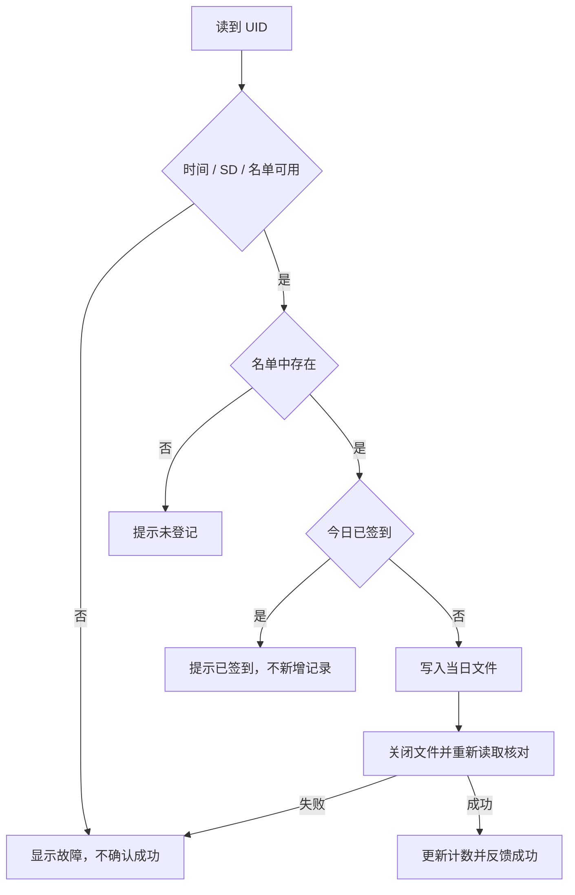

# 系统设计

## 固件模块

| 文件 | 责任 |
| --- | --- |
| `main.cpp` | 启动硬件自检、调度轮询、读取串口命令 |
| `nfc.cpp` | PN532 初始化、非重复呈现的卡片读取 |
| `attendance.cpp` | UID/名称校验、名单、当日去重、记录写入和读回 |
| `storage.cpp` | SD 挂载、只读诊断、测试文件校验 |
| `clock.cpp` | DS3231 访问、校时、有效时间判断 |
| `display.cpp` | 日期、签到状态、网络配置信息显示 |
| `feedback.cpp` | LED/蜂鸣器定时反馈与启动自检 |
| `button.cpp` | 去抖、短按事件和长按配网触发 |
| `network.cpp` | AP 配网、NVS 配置、Wi-Fi/TLS 工作任务 |
| `network_sync.h` | 网络队列结果、命令执行、名单与历史上传 |

OLED、RTC 各用一条 I2C，总线故障和接线可分别定位。PN532 与 SD 分开 SPI，SD 频率设为 400 kHz，优先保证当前杜邦线原型稳定性。

网络线程只处理连接和 HTTPS，不直接读写 SD。主循环生成上传内容和执行远程任务，工作线程完成请求后用结果队列返回。这样可避免两个线程同时修改名单和历史文件。

## 签到流程

## 后台数据

`Database` 管理人员、签到、审计和导入状态；`NetStore` 增加设备、配对码、网络事件和远程命令。USB 和网络版共享数据处理逻辑，网络表通过增量建表/加列创建。

| 表 | 主要用途 |
| --- | --- |
| `members` | UID、终端姓名、学号/分组/备注等管理字段 |
| `records` | 按日期和 UID 保存签到 |
| `audit` | 管理操作记录 |
| `net_devices` | 设备标识、密钥摘要、心跳与遥测、撤销状态 |
| `net_pairs` | 一次性配对码摘要、过期时间、已领取身份 |
| `net_events` | 上传事件标识及设备/日期/UID 唯一约束 |
| `net_commands` | 任务内容、状态、开始/完成时间、结果 |

事件 ID 为设备标识、日期和 UID 的规范拼接 SHA-256。服务器重新计算并校验，事务内写入整个批次；冲突行会导致该批次回滚，防止部分成功掩盖错误。

远程登记需名单读回成功；校时需 RTC 读回；名单和历史操作需服务器 ACK。任务可在领取或回执丢失后重试，登记同 UID 同名保持幂等，同 UID 异名返回冲突。

## 网络接口

设备使用 `X-Device-ID` 和 `Authorization: Bearer …`；初次配对请求通过一次性配对码认证。所有设备接口路径以 `/device/v1/` 开头。

| 方法与路径 | 功能 |
| --- | --- |
| `POST /device/v1/pair` | 初次配对或重新配对 |
| `POST /device/v1/heartbeat` | 心跳、能力、运行状态 |
| `POST /device/v1/events` | 批量上传签到事件 |
| `POST /device/v1/roster` | 上传终端名单 |
| `GET /device/v1/commands` | 领取待执行任务 |
| `POST /device/v1/command-ack` | 回报任务结果 |
| `GET /device/v1/time` | 获取后台时间 |

浏览器通过 `/api/bootstrap` 取得当前会话令牌，修改操作在 `X-Admin-Token` 中携带。常用管理接口包括 `/api/overview`、`/api/records`、`/api/members`、`/api/export`、`/api/backup` 和 `/api/network/*`。具体字段以 `admin/network_server.py`、`admin/netstore.py` 及测试为准。

生产入口只监听 `127.0.0.1:18080`。管理域名验证 Access JWT；设备域名仅开放设备路径，不能访问管理页面。`local_admin=true` 仅服务本地开发，请勿用于生产隧道。

## 前端刷新

前端为原生 HTML/CSS/JavaScript，无打包构建。初始化等待脚本就绪；周期刷新使用上次确认的状态，只有新请求返回后才更改表头，避免延迟时把联网设备临时显示成 USB 未连接。远程操作按钮按能力与已有任务状态启用，避免重复提交。
